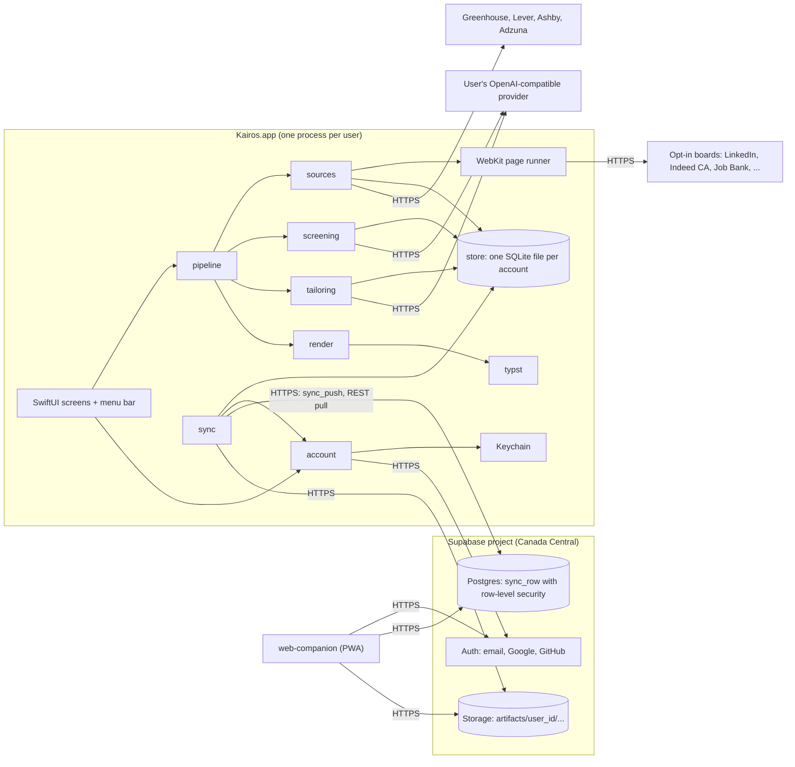
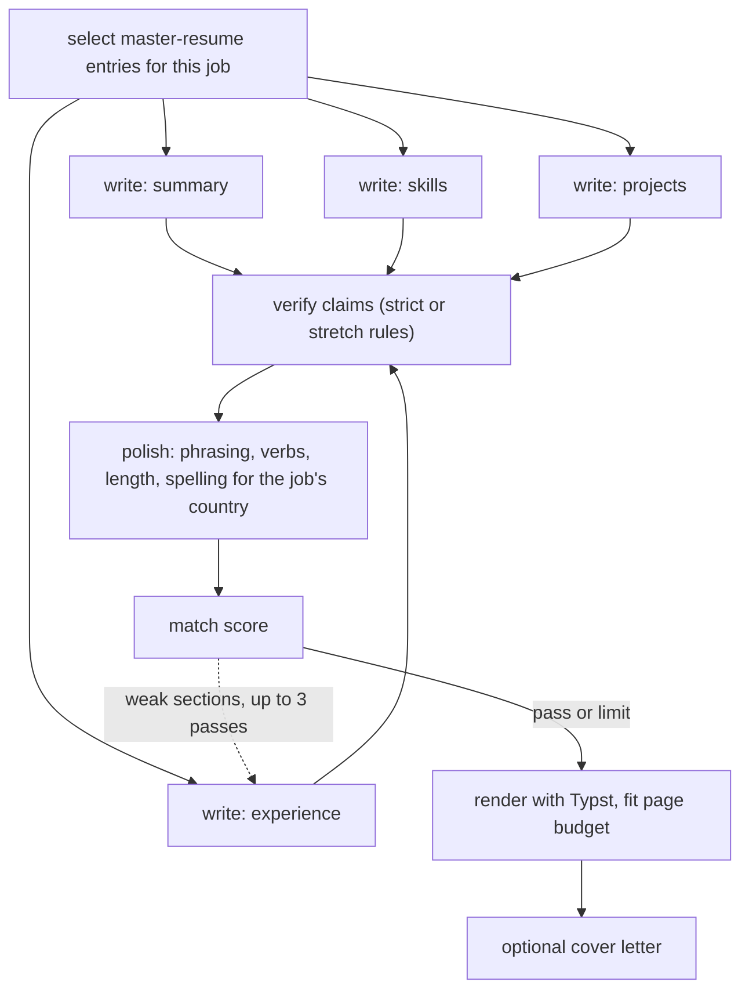
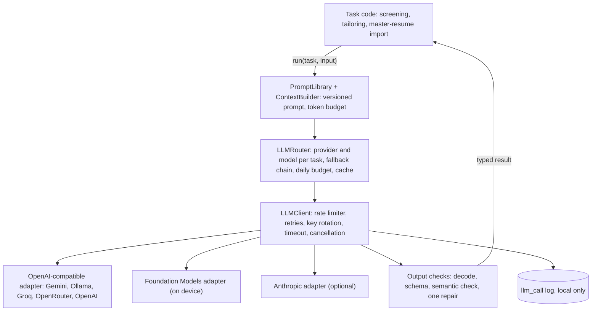

# Spec: Kairos for macOS (rebuild)

**Status:** Approved 2026-10-19. SwiftUI; the design is the brand and visual guide (§0). Implementation follows `tasks/plan.md`.
**Date:** 2026-10-18
**Replaces:** the Electron + Python design in `github.com/sneh2102/Kairos` @ `c219ea5`
**Process:** spec-driven-development. This is the Phase 0 capability map plus the project-level spec. Per-module specs (`SPEC-<module>.md`) are written only after this document is approved.
**Project rules:** `AGENTS.md` (read by every agent; `CLAUDE.md` imports it).
**Brand and visual guidelines:** `design/kairos/` (README.md, tokens.json, screens/, logo/). It sets how the app looks and feels and holds the logo. This spec decides what the app does: features, sources, screens and data.

---

## 0. Review decisions (2026-10-18)

| # | Question | Your answer | What changed in this spec |
|---|---|---|---|
| 1 | Just you, or friends too? | **Friends too, with sign-up and sign-in** | New `account` and `backend` modules. The online database moves from Turso to **Supabase**, because Turso has no end-user accounts (ADR-003, ADR-010). Invite-only sign-up. Per-user data isolation enforced by row-level security. |
| 2 | Pay $99/yr for the Apple Developer Program? | **No** | No notarization, CloudKit, Sign in with Apple, or native iPhone app for friends (free provisioning can't install on other people's phones). The phone client becomes an installable **web app (PWA)**, and releases are signed with a free self-signed certificate (ADR-012, ADR-013). |
| 3 | Windows within 12 months? | **Not for now** | SwiftUI stays. Hedge: the backend and the PWA are platform-neutral, so a Windows friend can already review and track jobs. Only the worker app would need porting later. |
| 4 | Honest-only resumes? | **No** | Adds an opt-in **Stretch mode** per user (§5.3, ADR-008). Hard limits still apply in every mode: employers, titles, dates, degrees, certifications and total years are never invented or changed. |
| 5 | Job markets | **US and Canada, Canada first** | Canadian sources and ranking first; screening rules for work authorization, French requirements and remote scope; Canadian or US spelling chosen per job; backend in Supabase's Canada (Central) region (§5.9). |
| 6 | macOS 26+, Apple silicon only | **Yes** | Unchanged. |
| 7 | Default LLM: Gemini Flash free tier, local Ollama fallback | **Yes** | Unchanged. Each user brings their own key; keys never leave their Mac. |
| 8 | Keep cover letters | **Yes** | Unchanged: optional per build. |
| 9 | "Lite" tailoring as an option | **Yes** | Per-build choice: full tailoring, or lite (summary and skills only; bullets copied from the master resume). |

**Second round**

| # | Question | Your answer | What changed in this spec |
|---|---|---|---|
| 10 | Who can invite? | **Only you** | `app_admin` contains only your account. No per-user invite allowance. |
| 11 | Stretch mode for new friends | **Off until each person turns it on** | Confirmed as the default (§5.3). |
| 12 | Email provider | **Brevo** | Brevo SMTP is configured in Supabase before the first invite (§5.8). |
| 13 | Base resumes for lite mode | **One master ("super") resume per user** holding everything they've done. Required: LinkedIn URL, phone, email. Optional: GitHub URL, portfolio URL. Editable any time | New `master-resume` module and §5.10. It replaces both the fact bank and the base resumes: every tailored resume and cover letter draws only from it, and lite mode uses it directly. |
| 14 | Public repo? | **Yes** | PWA on GitHub Pages. CI on GitHub Actions, which is free for public repos, macOS runners included (§7, §14). Secret scanning in CI. Needs a license and a `SECURITY.md` (Open Question 1). |
| 15 | Deeper LLM integration | — | §5.5 rewritten in full: layers, task catalog, prompts, structured output, reliability, budget, privacy, observability, testing. |

**Third round**

| # | Question | Your answer | What changed in this spec |
|---|---|---|---|
| 16 | License | **MIT** | `LICENSE` (MIT) with the original project credited in the README. Any reused code or prompts from the original keep its copyright notice. |
| 17 | Outside contributions | **Yes** | `CONTRIBUTING.md`; every pull request must pass CI. The commit-author rule applies to commits agents make for you, not to other contributors. |

**Fourth round**

| # | Question | Your answer | What changed in this spec |
|---|---|---|---|
| 18 | Design | **Approved** as the look and feel | Tokens, logo and visual rules live in `design/kairos/`; `CLAUDE.md` points every session to it. Colours come only from `tokens.json`. |
| 19 | Platform | **SwiftUI** | ADR-001 accepted. Native `NavigationSplitView`, `.inspector`, `.toolbar`, segmented pickers, switches, `MenuBarExtra` and SF Symbols, as the design's platform mapping says. |

**Fifth round**

| # | Question | Your answer | What changed in this spec |
|---|---|---|---|
| 20 | What the design governs | **Brand guidelines and inspiration only:** how things look and feel, plus the logo | Features, sources, screens and data come from this spec. The job sources and Adzuna are back to §5.4 as decided before the design. The spec's screens (including Jobs and Activity) stay, styled after the design. |

---

## 1. Assumptions still standing

1. **A small private group.** You plus up to about 10 invited friends. Sign-up is invite-only and you are the admin.
2. **Apple silicon Mac on macOS 26 or later** for anyone who runs the worker app. Anyone can use the PWA in a browser.
3. **"Minimize dependencies" applies to what ships.** Zero third-party Swift packages, one bundled binary (Typst), no frameworks in the PWA. Dev tools (Xcode, Supabase CLI) don't count.
4. **Local-first.** Each user's SQLite file is their source of truth. Supabase is the sync hub, the backup, and the bridge to the PWA. The Mac app works fully offline and without an account.
5. **Same job as today's Kairos:** find, screen, tailor, apply manually, track outcomes.
6. **Free tiers only.** Nothing paid is required. Each user supplies their own LLM key.

---

## 2. Your preferences, cross-checked

### Stated preferences

| Your preference | Alternatives weighed | Verdict | Why |
|---|---|---|---|
| **macOS first** | SwiftUI native · Tauri 2 · Electron (today) · Python + pywebview | **Keep. Build it in SwiftUI.** | Every capability needed ships in the macOS SDK: WebKit, PDFKit, Swift Charts, Keychain, SQLite, URLSession, `ASWebAuthenticationSession`, notifications, login items, and an on-device LLM. Electron plus Python plus Chromium is three runtimes and about 400 MB. If Windows becomes a yes, only the worker app needs porting (Tauri is the candidate). |
| **Minimize dependencies** | Zero packages · GRDB · Sparkle · supabase-swift · provider SDKs | **Keep. Zero packages, one binary.** | Supabase is used through its REST endpoints (auth, data, storage) over URLSession, so its SDK isn't needed. Dependencies worth taking later if the need appears: **GRDB** (if the SQLite wrapper grows past about 600 lines) and **supabase-swift** (if the hand-written auth client gets hairy). Sparkle is ruled out without a paid certificate; a GitHub Releases update check replaces it. |
| **Data in SQLite** | System SQLite + thin wrapper · SwiftData / Core Data · GRDB · DuckDB | **Keep. System `libsqlite3`.** | Single-file and transactional, the same database on every Mac, with a readable schema. SwiftData stores SQLite internally, but its schema is opaque. DuckDB is built for analytics, not app state. |
| **Plus a free online database** | **Supabase** · Turso · Cloudflare D1 · Neon · Firebase · CloudKit · PocketBase | **Keep, using Supabase.** It changed from Turso once friends and sign-in came in. | Sign-up and sign-in need real user accounts and per-user isolation. Supabase's free plan bundles all of it: Auth (50k monthly users, email and OAuth), Postgres with row-level security, 1 GB file storage, and SQL functions callable over REST. **Turso** has no end-user auth; it would need Clerk or Auth0 plus a token-minting backend. **D1** would need auth written by hand in a Worker. **Neon** has Auth and a Data API in beta, but no file storage and 0.5 GB. **Firebase** Storage has required a billing account since February 2026. **CloudKit** needs the paid program. **The catch:** free Supabase projects pause after a week with no activity. Daily syncs from any user's Mac prevent that, and a paused project only blocks sync, never local use. |

**Why Postgres no longer clashes with SQLite:** the remote side stores synced rows as JSON documents in one generic table (§6.3). The schema lives only in SQLite, the server never needs per-table migrations, and the SQL dialect difference stops mattering.

### Choices inherited from the original, also cross-checked

| Inherited choice | Replace with | Why it's better |
|---|---|---|
| LangGraph graphs (Python) | Swift structured concurrency | Small graphs; a framework adds a runtime and nothing else. |
| LaTeX via Tectonic or pdflatex, plus an LLM "LaTeX fixer" | **Typst** with JSON input | Nothing to escape, the fixer agent goes away, millisecond compiles, one static binary, tagged PDFs by default. |
| Playwright + Chromium scraping of 12 boards | **Tiered sources:** public ATS APIs → aggregator APIs → opt-in WebKit page runners | Stable, complete job descriptions, no terms-of-service risk for tiers A and B. WebKit replaces Chromium (about 300 MB). |
| Local FastAPI server + Cloudflare tunnels | **No local server.** In-process calls; remote access through Supabase with real accounts | Removes the CORS hole, the committed tunnel token and the unescaped callback found in the review. |
| Expo + tunnels for mobile | **PWA** on Supabase (R4) | Friends can't install a free-provisioned native iPhone app. A PWA works on iPhone, Android and any desktop, and needs no app store. |
| Separate Ollama / Gemini / Claude clients | **One OpenAI-compatible adapter** + Apple Foundation Models + optional Anthropic | One request shape covers six providers. |
| Two database files; applying moves a row | **One database** plus an `application` table | Atomic, and enables outcome tracking. |
| `resume.txt` / `projects.txt` free text | **One structured master resume per user** (§5.10) | One place every builder reads from, with ids on every bullet so code can check each tailored claim against it. |
| "Fabricated bullets" on by default (2 per role) | **Strict mode by default; Stretch mode opt-in per user,** with hard limits and every stretch bullet flagged for interview prep | Keeps the capability you want, makes it a conscious choice per user, and never lets it touch credentials. |
| LLM picks the verdict | **LLM extracts requirements; code computes the verdict** | Explainable, tunable, reproducible. |
| Every job sent to the LLM | **Deterministic prefilter first** | Free, instant, and should cut at least half the LLM calls. |
| Google Drive upload | **PDFs synced through Supabase Storage**; Finder export | One less OAuth integration; the PWA can open the PDFs. |

---

## 3. Objective

**What:** a native macOS app, plus a companion web app, that finds US and Canadian jobs worth applying to (Canada first), explains why, produces a tailored resume and cover letter for each in about two minutes, and tracks what happened after you applied. Shared with a few invited friends, each with their own private account and data.

**Why:** the original Kairos proved the workflow. This rebuild keeps the workflow and fixes its foundations: weight, fragility, security, multi-user safety, and control over how far the resume stretches.

**Users:** you (admin) and invited friends. Each runs the Mac app for the heavy work; anyone can use the PWA to review and track.

### User stories and acceptance criteria

1. **Invite and join.** I invite a friend by email. They download the app, sign up with that email (password, Google or GitHub), confirm it, and land in onboarding. Someone without an invite cannot create an account.
2. **Sign in anywhere.** I sign in on another Mac or in the PWA and see my data, and only my data. Signing out removes local session tokens; "Sign out everywhere" revokes every session.
3. **Morning queue.** Each morning there is a de-duplicated, screened list waiting, Canadian jobs first, without me starting anything.
4. **Explained verdicts.** For each job I see the requirements, which ones my master resume covers, work-authorization and language flags, and the rule or score behind the verdict. I can overrule it.
5. **One-click resume.** Build gives me a PDF within the page budget in ≤ 2 minutes (median, cloud LLM), plus an optional cover letter.
   - Strict mode: every bullet cites master-resume bullets, and no technology, number or year count appears that the master resume doesn't contain.
   - Stretch mode: invented bullets are allowed within hard limits, and each one shows up in an "Be ready to discuss" list.
6. **Track outcomes.** I mark a job applied and move it through screen, interview, offer, rejected or ghosted, with notes and follow-up reminders.
7. **Safe data.** If my Mac dies, signing in on a new Mac restores everything. I can export all my data, or delete my account and everything stored for it.
8. **One master resume.** I drop in my current resume (and optionally pick GitHub repos). The app drafts my master resume and asks for anything required that's missing: LinkedIn URL, phone, email. I can edit it any time, and every later resume and cover letter draws from it.

---

## 4. Capability map (Phase 0 gate)

Module ids are stable and will not be renamed.

| Module id | Responsibility | Depends on |
|---|---|---|
| `store` | SQLite wrapper, migrations, repositories, hybrid logical clock (HLC), UUIDv7, a separate database per account | — |
| `secrets` | Keychain: LLM keys, session tokens | — |
| `llm` | Provider adapters, router, typed tasks, prompt library, context budgeting, schema validation, rate limiting, budget, call log (§5.5) | `secrets`, `store` (for its local `llm_call` and `llm_cache` tables, as `master-resume` keeps its own repository; added in T23) |
| `sources` | `JobSource` protocol; ATS, aggregator and WebKit sources; URL normalization; de-duplication; location and country parsing | `store` |
| `master-resume` | The user's master resume: schema, required-field validation, versioning, editor model, import from a resume file or GitHub, full-length export (§5.10) | `store`, `llm` |
| `screening` | Prefilter rules (including work authorization, language, remote scope), job analysis, verdict, ranking | `store`, `llm`, `master-resume` |
| `tailoring` | Entry selection from the master resume, writers, claim verifier (strict and stretch), polish, match score, rewrite loop, lite mode, cover letter | `store`, `llm`, `master-resume` |
| `render` | Typst templates, JSON to PDF, page fitting, previews | `tailoring` (types only) |
| `pipeline` | Orchestration, build queue, cancellation, progress, scheduling | `sources`, `screening`, `tailoring`, `render` |
| `backend` | The Supabase project as code: SQL migrations, row-level security policies, `sync_push`, account deletion, invite hook, storage policies, auth settings checklist | — (deployed separately) |
| `account` | Sign-up, sign-in (password, Google, GitHub), email confirmation, password reset, session refresh, sign-out, invites, export, account deletion | `secrets`, `backend` (contract) |
| `sync` | Outbox, push through `sync_push`, pull over REST, PDF upload and download, command queue | `store`, `account` |
| `app-mac` | SwiftUI screens, menu bar, WebKit hosts, master-resume editor, account screens, notifications | `pipeline`, `sync`, `account`, `master-resume` |
| `cli` | Headless `kairos` commands (API sources only) | `pipeline`, `sync`, `account` |
| `web-companion` | PWA: sign-in, today's list, job detail, verdict override, queue builds, open PDFs, application tracking | `backend` (contract) |

**Build order:** `store`, `secrets` → `llm`, `sources` → `master-resume` → `screening` → `tailoring`, `render` → `pipeline` → `app-mac` (local) → `backend` → `account` → `sync` → `cli` → `web-companion`

Each Swift module is its own SwiftPM target, so the dependency direction is enforced by the compiler.

### Scope by release

| Release | Contents | Exit test |
|---|---|---|
| **R1 Local MVP** | `store`, `secrets`, `llm`, ATS sources, `master-resume`, `screening`, `tailoring` (strict, stretch, lite), `render`, `pipeline`, core screens, CI | Stories 4, 5 and 8 pass offline except for job APIs and the LLM |
| **R2 Daily driver** | Aggregator and WebKit sources, scheduler, menu bar, notifications, application tracking | Stories 3 and 6 pass for a week of real use |
| **R3 Accounts and sync** | `backend`, `account`, `sync`, `cli`; invite your first friend | Stories 1, 2 and 7; the isolation and restore tests in §13 pass |
| **R4 Companion** | `web-companion` on GitHub Pages | Story 2 in a phone browser; queueing a build from the phone works |

---

## 5. Architecture



### 5.1 Process model
- **One process, no server.** SwiftUI views observe `@Observable` models that call the core directly. There is no inbound port.
- **Menu bar extra** keeps the app resident; `SMAppService.mainApp` registers it as a login item.
- **CLI** (`kairos`) links the same core and runs API sources only.
- **One database per account:** `Application Support/Kairos/<user-id>/kairos.sqlite`, plus a `local/` database for use before signing in. On first sign-in the app offers to adopt the local data into the account.

### 5.2 Pipeline
1. **Fetch** from enabled sources in a `TaskGroup` (≤ 4 HTTP sources and 1 WebKit source at a time), with per-host delays and timeouts.
2. **Normalize:** canonical URL, Markdown description, and `job.id` = hash of the canonical URL (stable across devices). Parse `country` (CA or US), province or state, city, remote scope and currency.
3. **De-duplicate:** known ids, then cross-board near-duplicates (company + title + city similarity ≥ 0.9).
4. **Prefilter** (deterministic; the first failing rule wins and is recorded):
   - title include and exclude patterns
   - seniority policy
   - years required above your maximum
   - location policy: allowed provinces and states, remote allowed
   - **remote scope:** "Remote (US only)" when you lack US work authorization
   - **work authorization:** "no sponsorship" or "must be authorized to work in the US/Canada" against your profile
   - **security clearance** required (US) without one
   - **French required** ("bilingual", "français requis", or a French-language posting) when French isn't among your languages
   - blacklisted company
   - posting age
   - already applied (same company + similar title)
5. **Analyze** (one LLM call per survivor, JSON schema). The model extracts:
   - the requirements, each marked must or nice, and for each one which of your skills matches it, if any
   - seniority, years required and domains
   - sponsorship statements, clearance and language requirements, remote scope
   Cached per `(job, prompt_version)`.
6. **Verdict** (code) from must-have and nice-to-have coverage, the years and level policy, the authorization flags and your thresholds. The rule id is stored.
7. **Rank:** verdict first, then country priority (CA before US), then match. Today's list and notifications follow this order.
8. **Notify:** one notification with the counts of new `yes` and `maybe` jobs.

Job descriptions are **untrusted input** (OWASP LLM01). They sit inside clearly delimited data blocks in prompts. The model never chooses actions, and all of its output goes through schema validation and the verifier before use.

### 5.3 Tailoring

Every tailored resume and cover letter is built **only** from the user's master resume (§5.10). Code fills in contact details from the master resume's contact block; they never pass through the model.



**Modes**

| | Strict (default for every account) | Stretch (opt-in per user, off until they turn it on) |
|---|---|---|
| Core bullets | Rewritten from master-resume bullets; each cites the bullet ids it came from | Same |
| Gap bullets | None | Up to N per role (0–2, chosen per role) covering requirements the master resume doesn't |
| Technologies | Only those in the cited bullets or the master resume's skills | Gap bullets may also use skills marked **Can discuss** in the master resume |
| Numbers | Only from the cited bullets' metrics | Gap bullets may carry estimated metrics |
| Flagging | — | Every gap bullet is stored as `verified: false`, highlighted in the editor and listed under "Be ready to discuss" on the job. Never marked in the PDF. |

**Hard limits in every mode,** enforced by the verifier rather than by prompts:
- employer names, job titles and dates (must match a master-resume experience entry exactly)
- degrees, certifications and licenses (must exist in the master resume)
- total years of experience
- the hiring company's own internal products
- personal fields North American resumes omit: photo, date of birth, SIN/SSN, marital status

**Lite mode** (per build): code picks the most relevant master-resume bullets and copies them word for word. The model writes only the summary and the order and grouping of the skills line. That's 2 calls instead of 6–12, plus the cover letter if requested.

**Steps**
- **Select** (code first): score every master-resume bullet and project by overlap with the job's requirements (keywords, synonyms, recency). The `select` task breaks ties among near-equal candidates. The result is the set of entries each section may use.
- **Write:** section writers run in parallel and return `{"bullets":[{"text":…, "source_ids":[…], "gap":false}]}` against a JSON schema (§5.5).
- **Verify** (code): mode rules and hard limits. A failing bullet is regenerated up to twice, then falls back to the original master-resume bullet (or is dropped, for a gap bullet).
- **Polish** (code): swap AI-sounding phrases, de-duplicate opening verbs, enforce length, and use **Canadian spelling for Canadian jobs and US spelling for US jobs** (a word-list resource).
- **Match score** (code). Starting weights, tuned with fixtures:

  | Component | Weight |
  |---|---|
  | Must-have requirements | 40 |
  | Nice-to-have requirements | 10 |
  | Where evidence appears (bullets beat a skills list) | 15 |
  | Domain alignment | 10 |
  | Metrics | 10 |
  | Language quality | 10 |
  | Structure and length | 5 |

  Sections under 70 are rewritten, at most 3 passes, keeping the best version. One pass mark, 80 by default, used everywhere.
- **Render:** JSON → Typst → page count via PDFKit. If it runs over the budget, drop the lowest-ranked bullets and render again (no LLM).
- **Cover letter** (optional): the `coverLetter` task reads the job's requirements and the selected entries and returns paragraphs as JSON. The verifier applies the same rules to every claim in it, and code adds the greeting, your name and the contact line from the master resume.

### 5.4 Sources (Canada first)

| Tier | Sources | Access | Default |
|---|---|---|---|
| A: company ATS APIs | Greenhouse `boards-api.greenhouse.io/v1/boards/{token}/jobs?content=true` · Lever `api.lever.co/v0/postings/{slug}?mode=json` · Ashby `api.ashbyhq.com/posting-api/job-board/{org}` | Public JSON, no key | **On.** You keep a company watchlist; pasting a careers URL detects the ATS. Postings are filtered by parsed location. |
| B: aggregators | **Adzuna `ca` first, then `us`** (free key; about 25 calls/min and 250/day by default). WorkBC Job Posting API for BC is a candidate, to verify in the sources module spec | JSON with key | On if a key is set; Canada queried first in every run |
| C: page runners | LinkedIn, **Indeed Canada** (`ca.indeed.com`), Indeed US, Glassdoor, Google Jobs, Wellfound, **Job Bank** (`jobbank.gc.ca`; its open data is monthly CSV only, not daily) | Offscreen `WKWebView`, JavaScript extractor per board, cookie store per board, login in a visible WebKit sheet | **Off.** Opt in per board, with a warning that these break and may breach the site's terms |

A health check marks a source "degraded" after 3 runs in a row with zero results. Tier-C extractors are versioned `.js` resources.

### 5.5 LLM integration

**Goals:**
- each user brings their own key
- any OpenAI-compatible provider works
- every model output is structured and validated before use
- cost and rate limits are bounded
- the personal data sent out is the minimum each task needs
- the whole layer is testable without a network

#### Layers



#### Typed tasks

Every LLM use is a typed task, so calling code never handles raw text:

```swift
public protocol LLMTask: Sendable {
    associatedtype Input: Sendable
    associatedtype Output: Decodable & Sendable
    static var id: TaskID { get }                // e.g. .analyzeJob
    static var promptVersion: Int { get }        // bumped on every prompt change; part of cache keys
    static var outputSchema: JSONSchema { get }  // sent to providers that accept schemas; always checked locally
    func messages(for input: Input, budget: TokenBudget) -> [ChatMessage]
    func check(_ output: Output, for input: Input) throws  // rules a schema can't express
}

// LLMResult<JobAnalysis>: the output plus provider, model, tokens, latency and outcome
let result = try await llm.run(AnalyzeJobTask(), input: job)
```

#### Task catalog

| Task | Runs | Input sent | Output (JSON) | Default model | Budget in / out | Temp |
|---|---|---|---|---|---|---|
| `importResume` | Onboarding, re-import | Resume text (extracted with PDFKit) with contact details removed in code first: the values you entered, plus anything shaped like an email, phone number or profile URL | Master-resume draft: contact, experience, projects, education, skills, additional sections | Flash | 10k / 6k | 0 |
| `importGitHubRepo` | On request | Repo name, languages, README excerpt | One project entry | Flash-Lite | 3k / 600 | 0.2 |
| `triage` | Optional, before `analyzeJob` | Title + first ~1,500 characters of the posting | Relevant? Role family | On-device | ≤ 3.5k total | 0 |
| `analyzeJob` | Once per job that passes the prefilter | Cleaned posting + your skill names and languages only | Requirements (must or nice, matched skill), years, seniority, domains, flags (sponsorship, clearance, French, remote scope) | Flash-Lite | 7k / 1.5k | 0 |
| `select` | Per build, only to break ties | Requirements + one-line summaries of candidate bullets, with ids | Ranked ids | Flash-Lite | 4k / 500 | 0 |
| `writeSummary`, `writeSkills`, `writeExperience`, `writeProjects` | Per build, in parallel | Requirements + only the selected entries + mode rules + spelling locale | Bullets with `source_ids` | Flash | 4k / 1.5k each | 0.4 |
| `rewriteSection` | Per weak section, ≤ 3 passes | Current section + the score's findings | Bullets with `source_ids` | Flash | 3k / 1.5k | 0.4 |
| `gapBullets` | Stretch mode only | Uncovered requirements + role context + Can-discuss skills | Gap bullets, flagged | Flash | 3k / 800 | 0.5 |
| `coverLetter` | Per build, optional | Requirements + selected entries + company and title | Paragraphs | Flash | 4k / 1k | 0.6 |

"Flash" and "Flash-Lite" mean the newest model of that class the provider lists. Settings shows the exact ids fetched from the provider's `GET /models`, and the user can pin any of them per task. Lite models get the high-volume extraction work because free tiers give them higher limits.

**Volume:** a full build is about 6–12 calls (1 select, 4 writers, 0–6 rewrites, 0–1 gap, 0–1 cover letter); a lite build is 2–3. A typical day for one user (100 new jobs, about 40 past the prefilter, 5 builds) is about 85 calls.

#### Prompts and context
- **Layout:** the system message holds the role, rules and output contract. Those rarely change, so providers' prefix caching (Gemini's implicit caching, Anthropic's `cache_control`) can reuse them. The user message holds data in tagged blocks: `<job_posting>`, `<requirements>`, `<entries>`. The rules say text inside the blocks is data, never instructions.
- **Least context:** each task receives only what it needs. `analyzeJob` gets skill names, not the resume. Writers get only the selected entries. **No task ever receives contact details** (name, phone, email, LinkedIn, GitHub, portfolio) or local-only sensitive fields; code inserts contact details into the PDF and the letter.
- **Posting cleanup before sending:** HTML to Markdown; drop boilerplate (equal-opportunity statements, benefits lists) using heading heuristics. When truncating to the budget, keep the requirements, qualifications and responsibilities sections first.
- **Token estimates:** characters ÷ 4 before sending, corrected per provider and model from the `usage` numbers each response returns.
- **Versioned prompts:** `Prompts/<task>.v<N>.md` resources. Users may override a task's instructions in Settings, but the output contract and data blocks are fixed by code. Changing a built-in prompt bumps its version, which invalidates cached `analyzeJob` results.

#### Structured output

| Provider preset | How JSON is requested | Notes |
|---|---|---|
| Gemini (OpenAI-compatible endpoint) | `response_format` with a JSON schema | Google labels the compatibility layer beta. `reasoning_effort` maps to Gemini thinking levels, and thinking tokens count against output, so budgets include headroom |
| Ollama local (`localhost:11434/v1`) and Ollama Cloud (`ollama.com/v1`) | Learned per model: `response_format` where the model supports it, else the schema in the prompt only | Spike T20: `qwen3.5:4B` on Ollama 0.40 refuses every `response_format` (and the native `format`) with HTTP 501; the adapter resends once without it and remembers the model as prompt-only |
| Groq, OpenRouter, OpenAI | Schema where the model supports it, else JSON mode | Capability flag per preset |
| Anthropic (optional) | A forced tool call whose input schema is the output schema | — |
| Foundation Models | `@Generable` Swift types (guided generation) | No JSON parsing at all |

Whatever the provider promises, every reply goes through the same checks:
1. Decode the JSON, after stripping stray code fences.
2. Validate it against the task's schema with our own validator: about 200 lines covering the subset we use (objects, arrays, enums, ranges, required fields, maximum lengths).
3. Run the task's semantic check, for example that every `source_ids` value exists and no bullet is over 260 characters.
4. On failure, make one repair call that returns the error to the model; then try the task's fallback provider; then record a clear error on the build or job.

#### Reliability
- **Timeouts:** 60 s for extraction, 120 s for writing. Cancelling a run cancels its URLSession tasks.
- **Retries:**
  - Network errors and 5xx: 3 attempts with exponential backoff and jitter.
  - 429: rotate to the next key in the pool and honor `Retry-After`. When every key is limited, wait (≤ 60 s) or move to the next provider in the task's fallback chain (default: Gemini → local Ollama, if it's running).
  - 400, 401, 403 and 404: never retried; shown as "key rejected" or "model not found".
  - 501 "structured output is unavailable": never retried; resent once without `response_format` (T20).
  - A 429 whose quota limit is 0 means the model isn't on the user's plan: skip to the next model rather than wait (T20 saw a 14-hour retry delay).
- **Client-side rate limiter** per provider: requests per minute (default 10 for free tiers) and at most 2 concurrent calls, so runs don't trigger 429 storms.
- **Idempotent steps:** results are cached by (task, input hash, prompt version, model) in `llm_cache`. A crashed or cancelled build resumes from its last completed step instead of paying again.

#### Budget
- Per user: a daily call limit (default 300) and an optional token limit. When it's reached, LLM steps pause with "Daily AI budget reached" and the rest of the pipeline continues.
- Paid providers: a price per million tokens per model (preset or entered), so the app shows the estimated cost per build and per day. Free tiers show calls used today.

#### Observability (local only)
- **`llm_call` table**, one row per call:
  - time, task, provider, model, prompt version
  - input and output tokens, latency, attempt number
  - outcome (ok, repaired, rate-limited, fell back, failed) and error code
  - the job or build it belongs to

  **No prompt or response text** by default; a debug switch keeps redacted bodies for 24 hours.
- **Activity screen:** calls today per provider, failure rate, median latency and tokens. It warns when more than 20% of the last 20 calls failed.
- **`os.Logger` lines** carry ids and counts, never personal data.

#### Privacy
- What leaves the Mac, per task, is exactly the "Input sent" column above. Never sent: contact details, work authorization, clearance, other users' data, API keys.
- Free tiers can carry different data terms. Google's terms for its unpaid Gemini API services allow it to use submitted content to improve its products. Onboarding says this plainly and offers local Ollama as the private option. Re-check Google's current terms before launch.
- Keys live in each user's Keychain. Requests use HTTPS, except local Ollama on `localhost`.

#### On-device model
`SystemLanguageModel.default.availability` decides whether `triage` runs on device. Its context is 4,096 tokens for input and output combined, so it handles short classification only. When it's unavailable (no Apple Intelligence, or switched off), `triage` is skipped and the prefilter plus `analyzeJob` do the work.

#### Setup for each user
- Add a provider from a preset or a custom base URL.
- Add one or more keys; together they form the rotation pool.
- **Test** lists the provider's models through `GET /models`.
- Pick a model per task.
- Set the fallback chain, requests per minute and the daily budget.

New accounts start with the Gemini preset. Writing tasks use its newest Flash model, extraction tasks its newest Flash-Lite, and `triage` runs on device when available.

#### Testing
- A `FakeProvider` returns scripted replies per task id. It covers the router, rate limiter, retries, repair, fallback, budget and cache without a network.
- Adapter contract tests replay recorded HTTP exchanges for each preset.
- **Prompt evals** (opt-in, live): 30 fixture postings with hand-labelled requirements. A prompt or default-model change must keep must-have extraction at ≥ 0.85 precision and ≥ 0.80 recall, and the verifier pass rate at ≥ 95% on first write. `KAIROS_LIVE_LLM=1 swift test --filter PromptEvals` writes a report to `evals/`.
- `PromptPrivacyTests` renders every task's prompt for a fixture user and fails if any contact value appears in it.

### 5.6 Rendering
- `.typ` templates read `json(sys.inputs.data)`; style settings are inputs too.
- `typst compile --root <tmp> --font-path <bundled fonts> --ignore-system-fonts --input data=resume.json template.typ out.pdf`
- Templates are vendored, never fetched at compile time.

### 5.7 Security and privacy
- **No inbound network surface.** All server-side authorization lives in Supabase row-level security, never in the client.
- **Keys:** the app and the PWA ship only the Supabase **publishable** key (`sb_publishable_…`, safe in client code). The secret key never leaves the Supabase dashboard and is never in the repo. The legacy anon and service_role keys are not used; Supabase deprecates them by the end of 2026.
- **Keychain** holds LLM keys and the session (access and refresh tokens) as login-keychain items, which never sync through iCloud Keychain. The data protection keychain needs a paid-program team ID, so access is tied to the app's signature instead; spike T07 showed one stable self-signed certificate keeps that access across updates without prompts (`docs/spikes/keychain-signing.md`). Never in SQLite, Supabase, `UserDefaults` or logs.
- **Data classification:**

  | Class | Fields | Handling |
  |---|---|---|
  | Public | Job postings | Synced |
  | Personal | Master resume, builds, applications, notes | Synced, protected by row-level security |
  | Sensitive | Work-authorization and immigration status, clearance | **Local only.** Never synced, never sent to the LLM; used only by local prefilter rules. Re-entered after a restore. |
  | Secret | API keys, tokens | Keychain only |

- **Rights:** export all my data (JSON per table plus PDFs, into a folder), and delete my account (§5.8). Stated retention: §6.5.
- **Region:** Supabase project in **Canada (Central), `ca-central-1`**, which suits Canadian users' expectations under PIPEDA.
- **App Sandbox** on (outgoing network, user-selected folders). The bundled `typst` is signed with sandbox inheritance.

### 5.8 Accounts and authentication (`account` + `backend`)

**Sign-up and sign-in methods:** email + password (minimum 10 characters, with email confirmation), Google OAuth and GitHub OAuth (both free to set up). No Sign in with Apple, since it needs the paid developer program.

**Invite-only:**
- `invite(email, invited_by, created_at, used_at)`. Only rows in `app_admin` (you) can insert, enforced by row-level security.
- A Supabase **before-user-created hook** (Postgres function) rejects any sign-up whose email has no unused invite. This covers OAuth sign-ups too, since they also create users.
- After a user is created, a trigger marks the invite used.
- The app's Account screen has an "Invite a friend" field, visible to admins only.

**Flows** (all over Supabase Auth's REST endpoints with URLSession; no SDK):

| Flow | How |
|---|---|
| Sign up | `POST /auth/v1/signup` → confirmation email → link opens `kairos://auth/confirm` |
| Sign in (password) | `POST /auth/v1/token?grant_type=password` |
| Sign in (Google, GitHub) | `ASWebAuthenticationSession` with PKCE, redirect `kairos://auth/callback`, then exchange the code. Exact endpoint and parameter names to be verified against the Supabase Auth source in the `account` module spec |
| Refresh | `POST /auth/v1/token?grant_type=refresh_token`, proactively before expiry. On a 401: refresh once, then sign out |
| Password reset | `POST /auth/v1/recover` → link opens `kairos://auth/reset` → set the new password |
| Sign out / everywhere | `POST /auth/v1/logout` (local, or global scope) |
| Delete account | 1. Delete the user's storage objects through the Storage API. 2. Call RPC `delete_my_account()` (`SECURITY DEFINER`, uses `auth.uid()`), which deletes their `sync_row` rows and their auth user. 3. Wipe the local database and Keychain items. |

**Email delivery:** Supabase's built-in email only sends to project team members, at 2 per hour, so **Brevo** (free tier, with a documented Supabase integration) is set up as custom SMTP before the first invite. The SMTP credentials live only in the Supabase dashboard.

**Config checklist** (kept in `Backend/AUTH_SETTINGS.md`, because these live in the dashboard, not in SQL):
- redirect URL allowlist: `kairos://auth/*` and the PWA origin
- email confirmation on
- minimum password length 10
- Google and GitHub providers
- custom SMTP
- the before-user-created hook

### 5.9 Canada-first specifics
- **Defaults:** location "Canada", Adzuna `ca` before `us`, Indeed Canada before Indeed US.
- **Profile fields** (local only): work authorization per country, languages, clearance. For example: Canada = citizen, PR or open work permit; US = citizen, green card or needs a visa. If you're a Canadian citizen, US jobs that need authorization get an informational "possible TN route" flag. It never changes a verdict.
- **Currency:** salary parsed with currency; shown in the posting's currency with an approximate conversion.
- **Spelling and conventions:** Canadian spelling for Canadian postings, US spelling for US postings; the verifier blocks personal fields as listed in §5.3.

### 5.10 Master resume (`master-resume`)

One per user. It's the complete record of everything they've done, longer than any real resume, and the **only** source the resume and cover-letter builders read from. Screening uses it too: its skills and languages decide requirement matches and the French rule.

| Section | Fields | Required |
|---|---|---|
| Contact | full name, email, phone, LinkedIn URL, GitHub URL, portfolio URL, city / province or state / country | Name, **email**, **phone** and **LinkedIn URL** required. GitHub and portfolio optional |
| Headline and highlights | a short professional headline; free-text career highlights the summary writer may draw from | Optional |
| Work experience | employer, title, location, start and end month (or current), employment type, bullets (text, metrics, skills used) | At least one entry with one bullet before the first build |
| Projects | name, role, dates, tech, project URL, repo URL, bullets | Optional |
| Education | institution, credential, field, dates, location, honours, relevant coursework | Optional |
| Skills | name, category (language, framework, cloud, tool, …), level: **Proven** or **Can discuss** | At least 5 Proven skills before the first build |
| Additional | certifications (issuer, date, credential URL), awards, volunteering, publications, languages (with proficiency), and custom sections with a title and bullets | Optional |
| Total years of experience | a number the user enters | Required; code warns if it disagrees with the experience dates by more than a year |

- **Validation** (code, on save):
  - email format
  - phone normalized to E.164, with +1 as the default country code
  - LinkedIn must be `https://www.linkedin.com/in/<handle>`
  - GitHub must be `https://github.com/<user>`
  - portfolio must be an `https://` URL

  Missing required fields block Build and are shown inline.
- **Ids:** every entry and bullet has a stable id. Tailored bullets cite these ids, which is how the verifier checks claims.
- **Editing:** a dedicated screen with sections, inline editing, reordering, and Proven / Can discuss toggles on skills. Edits sync like everything else.
- **Versioning:** every save increments `master_version`. Each build records the version it used, so a resume made before an edit shows "Built from version 12; master resume edited since".
- **Import:** onboarding asks for the required contact fields first. `importResume` then drafts everything else from a PDF or pasted text, after code removes those values and anything shaped like an email, phone number or profile URL. `importGitHubRepo` drafts project entries from chosen repos. Drafts are shown for review, never saved silently.
- **Export:** a full-length "everything" PDF rendered by Typst (no page budget), plus JSON in the data export.

---

## 6. Data model and sync

### 6.1 Principles
- One SQLite file per account, WAL mode, STRICT tables.
- **Synced tables** carry `updated_hlc TEXT NOT NULL` (hybrid logical clock, compares as a string) and `deleted INTEGER NOT NULL DEFAULT 0` (a tombstone). **Local-only tables** never leave the Mac.
- Ids: `job.id` = the first 16 bytes of SHA-256 over the canonical URL, as lowercase hex; everything else UUIDv7.
- Times are INTEGER milliseconds since 1970 (UTC). Enum-like columns have no `CHECK` list, because a `CHECK` can't change without rebuilding the table; the Swift types hold the allowed values, and an unknown value is reported as a damaged row rather than guessed.
- No `FOREIGN KEY` constraints in synced tables (rows can arrive out of order). Integrity is enforced in repositories and checked by `kairos doctor`.
- Local migrations are append-only (`Schema/NNN_*.sql`). The server has its own migrations in `Backend/supabase/migrations/`, and they rarely change because the remote store is generic.

### 6.2 Local tables

| Table | Synced | Purpose | Key columns |
|---|---|---|---|
| `resume_contact` | yes | Master resume: contact and header (one row) | full_name, email, phone_e164, linkedin_url, github_url, portfolio_url, city, region, country, headline, highlights, total_years, master_version |
| `resume_entry` | yes | Master resume entries | kind (experience, project, education, certification, award, volunteering, publication, language, custom), fields JSON (per kind), start, end, sort |
| `resume_bullet` | yes | A bullet under an entry; its id is what tailored bullets cite | entry_id, text, metrics JSON, skills JSON, sort |
| `skill` | yes | Skills to draw from | name, category, level (proven, can_discuss), sort |
| `source` | yes | Configured sources | kind, config JSON, enabled, last_run_at, health, empty_runs (runs in a row with no results) |
| `search` | yes | Saved searches | terms JSON, location, countries JSON (ordered), remote, max_age_hours |
| `job` | yes* | Postings | source_id, url, canonical_url, dedup_key, company, title, location, city, country, region, remote_scope, currency, posted_at, salary JSON, description, state, verdict, verdict_source, rank, first_seen_at |
| `job_analysis` | yes | Requirements | job_id, requirements JSON, flags JSON (sponsorship, clearance, language, remote scope), domains JSON, model, prompt_version |
| `screening` | yes | Verdict trail | job_id, stage, verdict, rule_id, coverage JSON, reasons |
| `build` | yes | One tailoring run | job_id, mode (strict, stretch, lite), master_version, status, template_id, content JSON (bullets carry `source_ids` and `verified`), match_score, breakdown JSON, iterations, cover_letter JSON, error, timestamps |
| `artifact` | yes (metadata) | A PDF | build_id, kind, sha256, storage_path, local_path |
| `application` | yes | You applied | job_id, build_id, applied_at, channel, status, next_action_at, notes |
| `application_event` | yes | Timeline, append-only | application_id, kind, at, note |
| `template` | yes | Typst templates | name, source, style JSON, active |
| `prompt_override` | yes | Instruction edits per task | task_id, body, base_version |
| `setting` | yes | Non-secret settings | key, value JSON: job-search preferences (target titles, locations, countries in priority order), `stretch_mode`, page budget, LLM routing (provider and model ids per task, never keys) |
| `command` | yes | PWA-to-Mac queue | kind, payload JSON, status, device, result JSON |
| `run` | yes | Run history | kind, timestamps, stats JSON, error |
| `private_setting` | **no** | Sensitive profile | work_auth JSON, clearance |
| `llm_call` | **no** | One row per LLM call (§5.5), kept 30 days | at, task_id, provider, model, prompt_version, input_tokens, output_tokens, latency_ms, attempt, outcome, error_code, job_id, build_id |
| `llm_cache` | **no** | Reusable task results | task_id, input_hash, prompt_version, model, output JSON, created_at |
| `sync_outbox` | no | Pending pushes | table_name, row_id, hlc |
| `sync_state` | no | Watermark, device id, last sync | key, value |

\* Jobs rejected by the prefilter sync as **stubs** (title, company, country, verdict, rule; no description) to save remote space.

### 6.3 Remote schema (Supabase Postgres): one generic table

```sql
-- Backend/supabase/migrations/0001_sync.sql (abridged)
create table public.sync_row (
  user_id    uuid    not null references auth.users (id) on delete cascade,
  table_name text    not null,
  row_id     text    not null,
  hlc        text    not null,
  deleted    boolean not null default false,
  data       jsonb   not null,
  seq        bigint  not null,
  primary key (user_id, table_name, row_id)
);
create index sync_row_pull on public.sync_row (user_id, seq);
create sequence public.sync_seq;

alter table public.sync_row enable row level security;
create policy "read own rows" on public.sync_row
  for select to authenticated using (user_id = (select auth.uid()));
revoke insert, update, delete on public.sync_row from anon, authenticated;  -- writes only via sync_push

create function public.sync_push(rows jsonb) returns bigint
language plpgsql security definer set search_path = '' as $$
declare uid uuid := auth.uid();
begin
  if uid is null then raise exception 'not signed in'; end if;
  -- serialize this user's pushes so seq order matches commit order for their rows
  perform pg_advisory_xact_lock(hashtextextended(uid::text, 0));
  insert into public.sync_row as s (user_id, table_name, row_id, hlc, deleted, data, seq)
  select uid, r->>'t', r->>'id', r->>'hlc', coalesce((r->>'del')::boolean, false), r->'data',
         nextval('public.sync_seq')
  from jsonb_array_elements(rows) as r
  on conflict (user_id, table_name, row_id) do update
    set hlc = excluded.hlc, deleted = excluded.deleted, data = excluded.data, seq = excluded.seq
    where excluded.hlc > s.hlc;
  return (select max(seq) from public.sync_row where user_id = uid);
end $$;
```

Storage: private bucket `artifacts`; object path `<user_id>/<build_id>/<kind>.pdf`; policy allows a user only objects where the first folder equals `auth.uid()::text`.

Other backend objects:
- `invite` and `app_admin` with their row-level security policies
- the before-user-created hook function
- `delete_my_account()`
- `storage_usage()`, which reports database and bucket size for `kairos doctor`

### 6.4 Sync protocol (local-first, last writer wins per row)
1. **Local write:** the repository sets `updated_hlc`; a trigger appends to `sync_outbox`.
2. **Push** (every 60 s while signed in and online, after each pipeline stage, at quit): up to 200 outbox rows go as JSON to `POST /rest/v1/rpc/sync_push`, with the publishable key and the user's access token. Clear the outbox entries on success.
3. **Pull:** `GET /rest/v1/sync_row?select=table_name,row_id,hlc,deleted,data,seq&seq=gt.{watermark}&order=seq.asc&limit=500`. Row-level security restricts results to the caller's rows. Apply each row locally only if its `hlc` is newer, advance the watermark, and move the local clock past every HLC received.
   - Each user's pushes are serialized by the advisory lock, so their `seq` order equals commit order. A late push from an offline device always lands above every watermark and is never skipped.
4. **PDFs:** upload to Storage after a build completes; record `storage_path` in `artifact`. Other devices download on demand.
5. **New device or restore:** sign in, then pull from `seq = 0` and fetch PDFs lazily.
6. **Conflicts:** last writer wins per row. Application status changes also append an `application_event`, which is insert-only.
7. **Command queue:** the PWA inserts `command(status='pending')` through `sync_push`. The user's Mac pulls it, marks it `running`, executes it, and writes `done` or `failed`.
8. **Paused project:** if Supabase is unreachable, sync backs off and shows "Sync paused" while everything else keeps working.

Alternatives rejected: per-table mirrored Postgres schema (two dialects to migrate in lockstep); PostgREST upserts straight into tables (can't express conditional last-writer-wins, and can't guarantee pull ordering); realtime subscriptions (not needed at this scale).

### 6.5 Free-tier budget (Supabase, 10 users)

| Resource | Free plan | Estimate | Share |
|---|---|---|---|
| Database | 500 MB | ≈ 6.6 MB/user/month (stub rows for rejected jobs; JSONB compresses large descriptions); 120-day retention → ≈ 26 MB/user ≈ 260 MB | ≈ 52% |
| File storage | 1 GB | PDFs ≈ 24 MB/user/month; non-applied PDFs removed remotely after 30 days, applied after 180 (local copies are kept) → ≈ 600 MB at steady state | ≈ 60% |
| Egress | 5 GB/month | Pulls are small; PDF downloads on demand | < 20% |
| Monthly active users | 50,000 | ≤ 11 | ≈ 0% |
| Inactivity pause | after 1 week | Daily scheduled syncs keep it active | — |

`kairos doctor` warns the admin at 70% of either quota. The 2nd free project is used as **staging** for migrations and the row-level security tests.

**Retention:** jobs never shortlisted are archived after 60 days and tombstoned after 120. Applications are kept until the user deletes them or their account.

---

## 7. Tech stack

| Concern | Choice | Version policy |
|---|---|---|
| Language | Swift 6, language mode 6 | Toolchain from Xcode 26+ |
| UI | SwiftUI, Observation, Swift Charts, PDFKit, AppKit as needed | macOS 26 SDK |
| Design tokens | `design/kairos/tokens.json` → one Asset Catalog colour set per token (Any and Dark) plus named type, spacing and radius constants, generated by `scripts/gen-tokens.swift`; CSS custom properties for the PWA | Regenerated whenever `tokens.json` changes |
| Auth UI | `ASWebAuthenticationSession`, custom URL scheme `kairos://` | — |
| Local database | System `libsqlite3` via our wrapper | Check JSON1, FTS5 and STRICT at startup |
| Online backend | Supabase: Auth REST, PostgREST (`/rest/v1`), Storage REST, Postgres functions | Publishable keys only |
| Networking | URLSession, Codable | — |
| Browser automation | WebKit | — |
| PDF | Typst CLI, bundled, `aarch64-apple-darwin` | Pinned version + SHA-256 (0.15.1 current at time of writing) |
| On-device LLM | FoundationModels | macOS 26+ |
| Secrets | Keychain | — |
| Background | `SMAppService`, `NSBackgroundActivityScheduler`, UserNotifications | — |
| PWA | HTML, CSS and ES-module JavaScript, IndexedDB, a service worker; WebCrypto for PKCE | No framework, no build step, no npm packages |
| PWA hosting | GitHub Pages (free for public repos) | Deployed by CI on release |
| CI | GitHub Actions; standard runners, macOS included, are free for public repos | Runner image with Xcode 26 (confirm the label when writing the workflow) |
| Tests | Swift Testing; XCTest for UI smoke | Bundled |
| Formatting | `swift format` | Bundled with Swift 6 |
| Dev-only tools | XcodeGen (generates the Xcode project from `App/project.yml`), Supabase CLI (migrations), `gitleaks` | Not shipped |
| Third-party Swift packages | **None** | Adding one requires approval |

---

## 8. Commands

```bash
# One-time setup
xcodebuild -version                       # Xcode 26 or later
scripts/fetch-typst.sh                    # pinned typst into Vendor/typst/, verifies SHA-256
brew install supabase/tap/supabase        # dev tool for backend migrations
supabase login
supabase link --project-ref <ref> --workdir Backend

# Core
swift build  --package-path Packages/KairosCore
swift test   --package-path Packages/KairosCore
swift test   --package-path Packages/KairosCore --enable-code-coverage
swift format lint --strict --recursive Packages App
swift format --in-place --recursive Packages App

# App
xcodebuild -project App/Kairos.xcodeproj -scheme Kairos -destination 'platform=macOS,arch=arm64' build
xcodebuild -project App/Kairos.xcodeproj -scheme Kairos -destination 'platform=macOS,arch=arm64' test

# Backend (staging first, production after the isolation tests pass)
supabase migration new <name> --workdir Backend
supabase db push --workdir Backend        # applies Backend/supabase/migrations to the linked project
KAIROS_LIVE_SUPABASE=1 swift test --package-path Packages/KairosCore --filter BackendIsolation

# CLI (API sources only)
swift run --package-path Packages/KairosCore kairos signin
swift run --package-path Packages/KairosCore kairos scrape
swift run --package-path Packages/KairosCore kairos build <job-id>
swift run --package-path Packages/KairosCore kairos sync --once
swift run --package-path Packages/KairosCore kairos doctor

# PWA
python3 -m http.server 8080 --directory Web   # local preview (python3 comes with Xcode's command line tools)

# Opt-in live checks
KAIROS_LIVE=1 swift test --package-path Packages/KairosCore --filter Live
KAIROS_LIVE_LLM=1 swift test --package-path Packages/KairosCore --filter PromptEvals   # report in evals/<date>-<model>.json

# Guards and release
scripts/check-deps.sh                     # fails on any resolved Swift package or unlisted bundled binary
scripts/release.sh                        # archive → sign with the project's self-signed cert → DMG → GitHub Release

# CI (.github/workflows)
# ci.yml      on every pull request: format lint, swift test, check-deps, check-commits, gitleaks
# release.yml on a v* tag: build, sign, DMG, GitHub Release, deploy Web/ to GitHub Pages
```

---

## 9. Project structure

```
kairos-mac/
├── AGENTS.md                   project rules for every agent (skills check, commit authorship, boundaries)
├── CLAUDE.md                   imports AGENTS.md
├── SPEC.md                     this document
├── CONSTRAINTS.md              quality bar (§14), created on approval
├── LICENSE                     MIT; the original Kairos is credited in the README
├── CONTRIBUTING.md, SECURITY.md
├── .github/workflows/          ci.yml, release.yml
├── design/kairos/              brand and visual guidelines: README.md, tokens.json, screens/*.dc.html, logo/
├── docs/decisions/             Appendix A split into ADR files once accepted
├── App/
│   ├── Kairos.xcodeproj
│   ├── Kairos/                 KairosApp.swift, Screens/, MasterResume/, Account/, Components/, MenuBar/, WebKitHost/, Onboarding/
│   └── KairosUITests/
├── Packages/KairosCore/
│   ├── Package.swift           one target per module id (§4)
│   ├── Sources/
│   │   ├── Store/              wrapper, migrator, repositories, HLC, UUIDv7, Schema/NNN_*.sql
│   │   ├── Secrets/
│   │   ├── LLM/                tasks, router, client, adapters, schema validator, rate limiter, budget, Prompts/<task>.v<N>.md
│   │   ├── JobSources/         ATS, Adzuna, WebKit runner, Extractors/*.js, Geo/ (provinces, states, cities)
│   │   ├── MasterResume/       model, validation, versioning, import mapping, export
│   │   ├── Screening/          prefilter rules, analysis, verdict, ranking
│   │   ├── Tailoring/          select, writers, verifier, polish, score, cover letter, Synonyms.json, Spelling/ (en-CA, en-US)
│   │   ├── Render/             Typst runner, Templates/*.typ, Fonts/
│   │   ├── Pipeline/
│   │   ├── Account/            auth client, session store, PKCE, invites, export, deletion
│   │   ├── Sync/               outbox, push, pull, storage client, commands
│   │   └── KairosCLI/
│   └── Tests/<Module>Tests/, Tests/Fixtures/
├── Backend/
│   ├── supabase/migrations/    0001_sync.sql, 0002_invites.sql, 0003_account.sql, 0004_storage.sql, ...
│   └── AUTH_SETTINGS.md        dashboard settings that aren't SQL (Brevo SMTP, providers, redirect URLs)
├── Web/                        PWA: index.html, app.js, auth.js, sync.js, sw.js, manifest.webmanifest, styles.css
├── evals/                      prompt-eval reports, committed for comparison
├── Vendor/typst/               fetched by script, gitignored
└── scripts/                    fetch-typst.sh, check-deps.sh, check-commits.sh, release.sh
```

---

## 10. Code style

```swift
/// A place jobs come from. Sources only fetch and map; they never write to the store.
public protocol JobSource: Sendable {
    var id: SourceID { get }
    func fetch(_ query: SourceQuery) async throws -> [Posting]
}

public struct GreenhouseSource: JobSource {
    public let id: SourceID
    let boardToken: String
    let http: any HTTPClient

    public func fetch(_ query: SourceQuery) async throws -> [Posting] {
        guard let url = URL(string: "https://boards-api.greenhouse.io/v1/boards/\(boardToken)/jobs?content=true") else {
            throw SourceError.invalidConfiguration("Greenhouse board token: \(boardToken)")
        }
        let page = try await http.getJSON(url, as: GreenhousePage.self)
        return page.jobs.map { job in
            Posting(
                sourceID: id,
                url: job.absoluteUrl,
                company: query.companyName ?? boardToken,
                title: job.title,
                location: job.location.name,
                postedAt: job.updatedAt,
                descriptionHTML: job.content ?? ""
            )
        }
    }
}

struct GreenhousePage: Decodable {
    struct Job: Decodable {
        struct Location: Decodable { let name: String }
        let title: String
        let updatedAt: Date
        let absoluteUrl: URL
        let location: Location
        let content: String?
    }
    let jobs: [Job]
}
```

Conventions:
- Swift 6 mode; `Sendable` across concurrency boundaries; shared mutable state in actors.
- Dependencies arrive through protocols in initializers (`HTTPClient`, `LLMProvider`, `Clock`, `AuthSession`, `RemoteStore`). No singletons except the app environment root.
- No `try!`, force unwraps or `fatalError` outside tests. Typed error enums per module.
- SQL always uses bound parameters. Prompts are versioned resources.
- `UpperCamelCase` types, `lowerCamelCase` members, `snake_case` SQL. File name = primary type.
- PWA: plain ES modules, `const`/`let`, no globals except one `app` namespace, `textContent` (never `innerHTML`) for any data from the server or a job description.
- Comments explain why, not what.

---

## 11. Testing strategy

| Level | What | How |
|---|---|---|
| Unit | Prefilter rules (including authorization, French and remote scope), verdict, ranking, verifier (strict, stretch, hard limits), polish and spelling, score, URL canonicalization, de-duplication, geo parsing, HLC, UUIDv7, PKCE verifier and challenge, token-expiry logic | Swift Testing, table-driven |
| Store | Migrations, repositories, triggers, per-account file layout | In-memory SQLite |
| Master resume | Required fields (email, E.164 phone, LinkedIn and GitHub URL shapes), versioning, import-draft mapping | Swift Testing; recorded `importResume` replies |
| LLM layer | Router, rate limiter, retries, key rotation, repair, fallback, budget, cache, prompt privacy | `FakeProvider`, fake clock |
| Prompt evals (live, opt-in) | Requirement extraction precision and recall; verifier pass rate on first write | `KAIROS_LIVE_LLM=1`, report in `evals/` |
| Source contract | Recorded API and HTML fixtures | Fake `HTTPClient` |
| Pipeline integration | Fetch → build → render, end to end | Fake source and LLM, real SQLite and Typst; PDF text checked with PDFKit |
| Account | Sign-up, sign-in, refresh, 401 handling, sign-out, deletion order | Fake auth server (`URLProtocol`) with recorded Supabase responses |
| Sync | Convergence and restore | Two local replicas plus a fake remote that mimics `sync_push` and the pull query, with random edit sequences converging to identical per-table hashes |
| **Backend isolation** (live, staging project) | User B cannot read or overwrite user A's rows or objects; a non-invited email cannot sign up; `delete_my_account` leaves nothing behind | `KAIROS_LIVE_SUPABASE=1`, two disposable test accounts. **Required before any `supabase db push` to production.** |
| Live smoke | One company each on Greenhouse, Lever, Ashby; Adzuna `ca` | `KAIROS_LIVE=1` only |
| UI | Launch, sign in with a fake backend, onboarding, open a job, build | XCUITest |
| PWA | Sign in, list, verdict override, command queue, PDF open | Manual checklist in R4 plus browser-testing-with-devtools |

- No network in the default run.
- Coverage ≥ 80% lines on `screening`, `tailoring`, `master-resume`, `llm`, `store`, `account`, `sync`.
- Test-first for the verifier, prefilter, sync and account flows.

---

## 12. Boundaries

**Always**
- **Before handling any request, check the installed agent skills for relevant ones, say which apply, and follow them** (see `AGENTS.md`).
- **Make every commit as Kenee Patel <patelkenee2804@gmail.com>, both author and committer, with no AI co-author or attribution trailers** (see `AGENTS.md`).
- Run `swift test` and `swift format lint --strict` before every commit.
- Keep migrations append-only, local and backend alike.
- Validate every LLM output against its schema; record `model` and `prompt_version`.
- Read `design/kairos/README.md` before any UI change for the look and feel, and take every colour, type style, spacing value and radius from `tokens.json`. Features and content follow this spec.
- Build every tailored resume and cover letter only from the user's master resume.
- Let the verifier enforce the hard limits in every mode, and flag every stretch bullet.
- Treat job descriptions and model output as untrusted data.
- Keep secrets and sessions in the Keychain only.

**Ask first**
- Adding any Swift package, bundled binary, npm package or new network host.
- Changing a backend migration, a row-level security policy, a Supabase auth setting or the invite policy.
- Changing the sync protocol or the set of local-only fields.
- Adding or re-enabling a tier-C source.
- Changing default LLM providers, score weights, the pass mark, or stretch-mode limits.
- Changing a built-in prompt or a task's default model. Run the prompt evals and attach the report.
- Changing the master resume's required fields.

**Never**
- Commit or log secrets, tokens or the Supabase secret key. Ship only the publishable key.
- Disable row-level security, or write to `sync_row` other than through `sync_push`.
- Sync or send to an LLM anything classed as sensitive.
- Send contact details or other users' data to any LLM.
- Invent or alter employers, titles, dates, degrees, certifications or total years, in any mode.
- Submit job applications automatically.
- Run a local HTTP server or open an inbound port.
- Delete user data without confirmation, or hard-delete synced rows (tombstone them).
- Weaken `CONSTRAINTS.md`, skip tests, or add suppressions to make a change pass.

---

## 13. Success criteria

| # | Criterion | How it's checked |
|---|---|---|
| S1 | Fresh Mac: install, sign up with an invited email, confirm, onboard from a resume, add 3 companies, run. Screened jobs appear within 2 minutes | Manual acceptance script, `docs/acceptance.md` |
| S2 | A non-invited email can't sign up by password or OAuth | `BackendIsolation` live test |
| S3 | User B can't read, overwrite or delete user A's rows or PDFs through any endpoint | `BackendIsolation` live test |
| S4 | Deleting an account leaves 0 `sync_row` rows, 0 storage objects and no auth user for it | `BackendIsolation` live test |
| S5 | Restore: sign in on a clean Mac, and every synced table matches its content hash from before | `SyncTests.restoreRoundTrip` + manual run |
| S6 | Prefilter removes ≥ 50% of raw postings before any LLM call over a week of real runs | `run.stats` |
| S7 | Canadian postings rank above US ones of equal verdict and match | `ScreeningTests.rankingCanadaFirst` |
| S8 | Build median ≤ 120 s (cloud LLM); Typst render ≤ 1 s; output within the page budget | `build` timings, PDFKit page count |
| S9 | Strict mode: 0 claims unsupported by the master resume across the 30-job fixture suite. Stretch mode: 0 hard-limit violations, and 100% of gap bullets flagged | `swift test --filter VerifierSuite` |
| S10 | Third-party Swift packages = 0; bundled binaries = `typst`; PWA has no npm packages | `scripts/check-deps.sh` |
| S11 | App ≤ 80 MB; launch to an interactive window ≤ 1.5 s on an M1 | `du -sh`; Instruments |
| S12 | No secrets in the repo, database, Supabase rows or logs | `gitleaks detect --redact`; `kairos doctor` |
| S13 | Every commit in the repo is authored and committed by Kenee Patel with no AI trailers | `git log --format='%an <%ae>|%cn <%ce>|%(trailers)'` check in `scripts/check-commits.sh` |
| S14 | Build stays blocked, with the missing fields shown, until the master resume has a name, a valid email, a phone number and a LinkedIn URL | `MasterResumeTests` + UI test |
| S15 | ≥ 98% of LLM calls end valid (first try or after one repair) over a week of real use, and no prompt ever contains a contact value | `llm_call` outcomes; `PromptPrivacyTests` |

---

## 14. Quality bar

The canonical, enforced version is `CONSTRAINTS.md`. If this section and that file ever differ, the file wins.

**Floor**
- No new `try!`, force unwraps or format-ignore comments outside tests.
- No skipped or deleted tests without a reason in the commit message.
- No secrets in source. No new dependencies without approval.
- Commits authored and committed by Kenee Patel, no AI trailers.
- This file is not weakened to make a change pass.

| Dimension | Rule | Checked by | Runs at |
|---|---|---|---|
| Format | Zero findings | `swift format lint --strict --recursive Packages App` | Every change |
| Concurrency | Zero warnings, Swift 6 mode | `swift build` with warnings as errors | Every change |
| Tests | All pass, no network | `swift test --package-path Packages/KairosCore` | Every change |
| Coverage | ≥ 80% lines in `screening`, `tailoring`, `store`, `account`, `sync` | `--enable-code-coverage` + `llvm-cov report` | Task end |
| Isolation | All pass on staging | `KAIROS_LIVE_SUPABASE=1 swift test --filter BackendIsolation` | Before any production `db push` |
| Dependencies | 0 packages; binaries = typst | `scripts/check-deps.sh` | Every change |
| Commits | Author and committer = Kenee Patel; no trailers | `scripts/check-commits.sh` | Before push |
| Secrets | No findings | `gitleaks detect --redact --no-banner` | Before commit |
| Prompts | Evals meet the §5.5 thresholds | `KAIROS_LIVE_LLM=1 swift test --filter PromptEvals` | Any prompt or default-model change |
| Size | App ≤ 80 MB | `du -sh build/Kairos.app` | Release |

Every "every change" and "before commit" row also runs in CI (`.github/workflows/ci.yml`) on each pull request. A red check blocks merging.

---

## 15. Risks

| Risk | Likelihood | Mitigation |
|---|---|---|
| Supabase free project pauses after a week of no activity | Low with daily use | Daily syncs; the app degrades to local-only; documented restore steps for the admin |
| Free SMTP limits or deliverability block sign-ups | Medium | Custom SMTP from day one; invite-only keeps volume tiny; OAuth sign-up avoids email entirely |
| Unsigned app: friends must approve it in System Settings → Privacy & Security on first launch (macOS 15 removed the Control-click bypass), and ad-hoc signatures can trigger Keychain prompts after updates | High (first launch) | Releases are signed with one stable self-signed certificate, so the code identity stays the same across updates (verified in spike T07). Note from T07: the login keychain may also admit another build with the same bundle ID without a prompt, which is acceptable for keys users can rotate. Written install guide with screenshots |
| Stretch-mode bullets get probed in interviews | Per user | Opt-in, hard limits, "Be ready to discuss" list per job |
| Tier-C boards break or block automation | High | Off by default; extractors are resources; health checks |
| Free LLM tiers shrink | High | Any OpenAI-compatible provider; local Ollama; prefilter; budget guard |
| A provider changes or retires a free model | High | Model ids fetched live; prompt evals rerun on model change; fallback chain |
| Free-tier data terms (Gemini's unpaid tier may use submitted content to improve Google's products) | Certain for that tier | Minimal context, no contact details, disclosure in onboarding, local Ollama option |
| Free-tier storage fills with more friends | Medium | Stub rows, retention, `kairos doctor` alert at 70%; upgrade path is the admin's choice |
| Supabase changes plans or deprecates APIs | Medium | Generic row store keeps the server surface to 1 table, 3 functions and 1 bucket, so a port to another backend is small |
| PWA limits on iPhone (storage eviction, notifications only after "Add to Home Screen") | Medium | The PWA treats its cache as disposable and re-pulls; no reliance on push in R4 |

---

## 16. Not doing

- Automatic application submission.
- A native iPhone app (no paid developer program); revisit if that changes.
- Windows or Linux worker apps (for now).
- Sign in with Apple; magic-link sign-in.
- Shared data between friends (shared job pools, shared watchlists) in v1.
- An admin dashboard beyond invites and the `kairos doctor` quota report.
- LaTeX templates, Google Drive, a local web server or tunnels.

---

## 17. Open questions

None. XcodeGen was approved as a dev-only tool on 2026-10-19 (plan decision P1).

---

## Appendix A — Decision records

Each decision has its own file in `docs/decisions/` (Status, Date, Context, Decision, Alternatives, Consequences). Add new ones there with the next number.

| ADR | Decision |
|---|---|
| [ADR-001](docs/decisions/ADR-001-native-swiftui-app.md) | Native SwiftUI app |
| [ADR-002](docs/decisions/ADR-002-system-sqlite-with-a-thin-wrapper.md) | System SQLite with a thin wrapper |
| [ADR-003](docs/decisions/ADR-003-supabase-as-the-online-database-supersedes-turso.md) | Supabase as the online database (supersedes "Turso") |
| [ADR-004](docs/decisions/ADR-004-typst-instead-of-latex.md) | Typst instead of LaTeX |
| [ADR-005](docs/decisions/ADR-005-tiered-job-sources-public-apis-first-canada-first.md) | Tiered job sources, public APIs first, Canada first |
| [ADR-006](docs/decisions/ADR-006-swift-concurrency-instead-of-an-agent-framework.md) | Swift concurrency instead of an agent framework |
| [ADR-007](docs/decisions/ADR-007-typed-llm-tasks-over-one-openai-compatible-adapter.md) | Typed LLM tasks over one OpenAI-compatible adapter |
| [ADR-008](docs/decisions/ADR-008-master-resume-verifier-strict-and-stretch-modes.md) | Master resume, verifier, strict and stretch modes |
| [ADR-009](docs/decisions/ADR-009-code-computes-the-verdict.md) | Code computes the verdict |
| [ADR-010](docs/decisions/ADR-010-accounts-supabase-auth-invite-only.md) | Accounts: Supabase Auth, invite-only |
| [ADR-011](docs/decisions/ADR-011-generic-remote-row-store.md) | Generic remote row store |
| [ADR-012](docs/decisions/ADR-012-pwa-companion-instead-of-a-native-iphone-app.md) | PWA companion instead of a native iPhone app |
| [ADR-013](docs/decisions/ADR-013-distribution-without-the-paid-developer-program.md) | Distribution without the paid developer program |
| [ADR-014](docs/decisions/ADR-014-one-master-resume-per-user.md) | One master resume per user |

---

## Appendix B — References (checked 2026-10-18)

- Supabase pricing (free plan: 50k monthly users, 500 MB, 1 GB storage, pause after 1 week): https://supabase.com/pricing
- Supabase regions (`ca-central-1`): https://supabase.com/docs/guides/platform/regions
- Supabase custom SMTP (default email only to team members, 2/hour): https://supabase.com/docs/guides/auth/auth-smtp
- Supabase before-user-created hook: https://supabase.com/docs/guides/auth/auth-hooks/before-user-created-hook
- Supabase publishable and secret keys: https://supabase.com/docs/guides/getting-started/migrating-to-new-api-keys
- Supabase PKCE flow: https://supabase.com/docs/guides/auth/sessions/pkce-flow
- Supabase Auth endpoints: https://github.com/supabase/auth
- Brevo + Supabase SMTP: https://developers.brevo.com/docs/supabase-smtp-integration
- Turso JWKS auth (Clerk, Auth0, beta): https://docs.turso.tech/sdk/authorization/jwks
- Neon Data API and Auth: https://neon.com/docs/data-api/overview
- Firebase Storage now requires Blaze: https://firebase.google.com/docs/storage/faqs-storage-changes-announced-sept-2024
- Cloudflare D1 pricing: https://developers.cloudflare.com/d1/platform/pricing/
- Typst 0.14 (tagged PDF): https://typst.app/blog/2025/typst-0.14 · changelog: https://typst.app/docs/changelog/
- Apple Foundation Models context size: https://www.infoq.com/news/2026/03/apple-foundation-models-context
- Greenhouse Job Board API: https://jobspipe.dev/sources/greenhouse.md
- Lever Postings API: https://100hires.com/lever-api.html
- Ashby Job Board API: https://jobspipe.dev/sources/ashby.md
- Adzuna API limits: https://jobspipe.dev/blog/adzuna-api
- Job Bank open data (monthly CSV): https://open.canada.ca/data/en/dataset/ea639e28-c0fc-48bf-b5dd-b8899bd43072
- Gemini OpenAI compatibility: https://ai.google.dev/gemini-api/docs/openai
- macOS Sequoia Gatekeeper change: https://thehackernews.com/2024/08/apples-new-macos-sequoia-tightens.html

- Gemini OpenAI compatibility (base URL, `reasoning_effort` mapping, beta status): https://ai.google.dev/gemini-api/docs/openai
- Gemini free-tier model availability (2026): https://www.costbench.com/software/llm-api-providers/google-gemini-api/free-plan/
- Ollama OpenAI compatibility (`/v1`, JSON mode, cloud at `https://ollama.com/v1`): https://docs.ollama.com/api/openai-compatibility
- GitHub Actions billing (standard runners free for public repos): https://docs.github.com/en/billing/concepts/product-billing/github-actions

Third-party summaries were used where the vendor page wasn't fetchable; re-check the numbers against vendor pages before relying on them.
